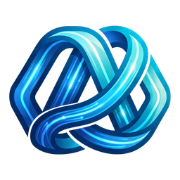
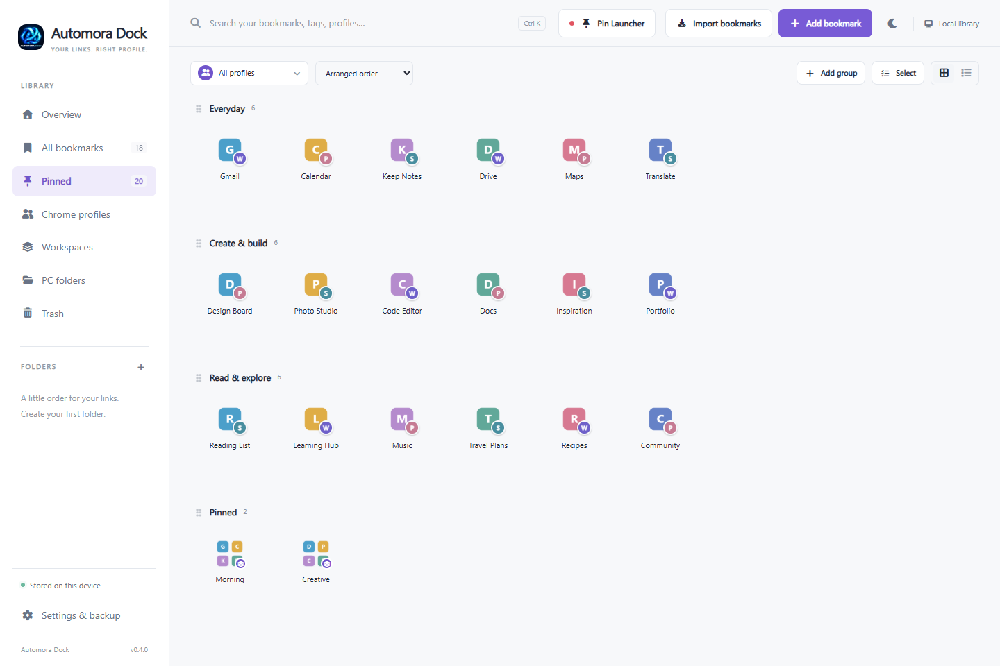
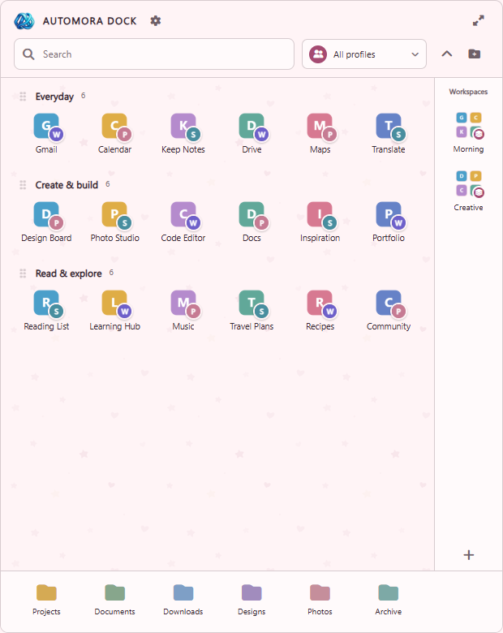
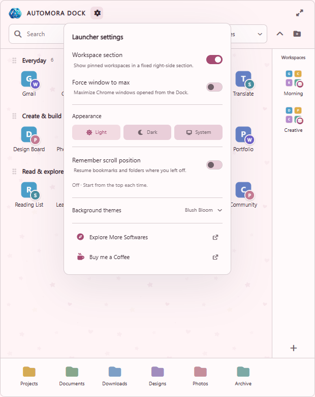
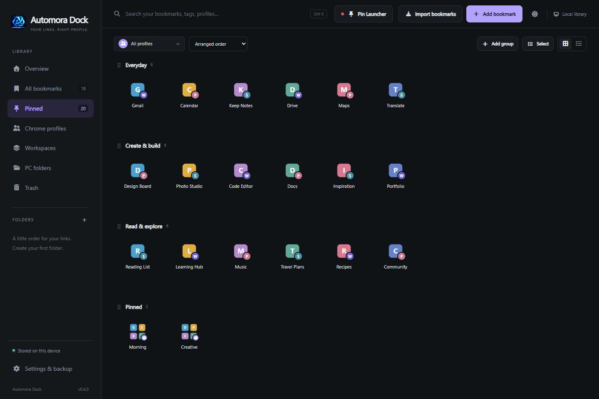
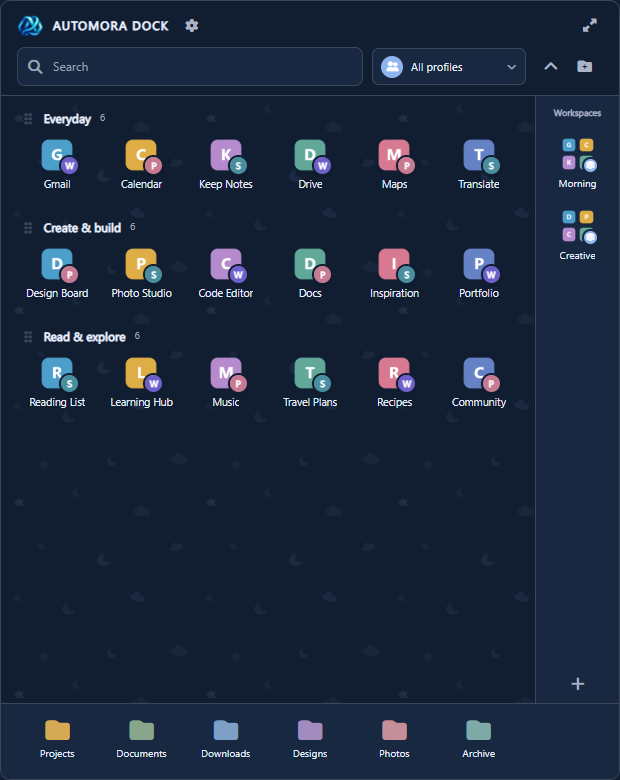
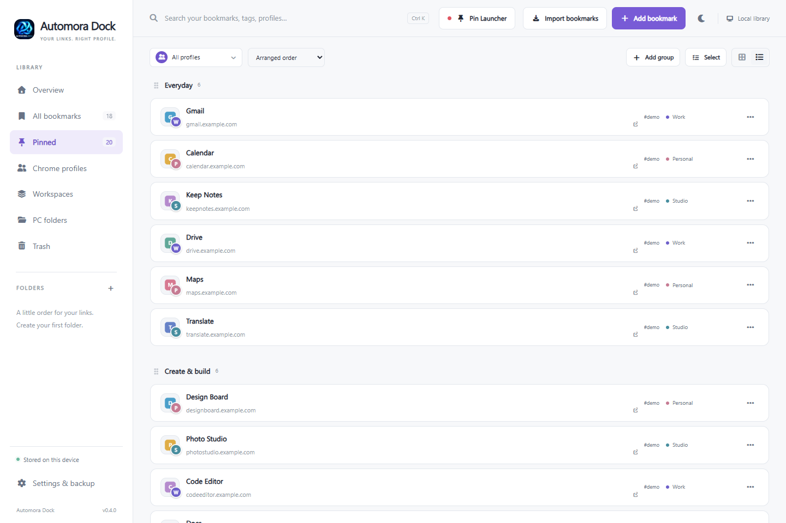

<div align="center">
  
  <h1>Automora Dock</h1>
  <p>Your links. The right Chrome profile. One compact Windows launcher.</p>
  <p>  </p>
  <p><a href="https://automoralabs.store/">Explore more software</a> · <a href="https://buymeacoffee.com/rishichaurasiya">Buy me a Coffee</a></p>
</div>

Automora Dock keeps bookmarks from multiple Chrome profiles in a local library. Each bookmark opens in its assigned profile. Organize links into pinned groups, shortcut folders and workspaces, then open them from a compact taskbar launcher or the full manager.



## Features

- Detect local Chrome profiles, including custom user-data locations; selectively import folders and bookmarks.
- Keep profile routing and avatar badges attached to each bookmark. Re-import preserves custom titles, tags, notes, pins and trash state.
- Pin bookmarks, folders, profiles and workspaces; arrange named groups by drag or keyboard.
- Drag one shortcut onto another to create a shortcut folder with a popup.
- Workspaces show a four-icon preview and open their saved links in the assigned profiles.
- Pin PC-folder shortcuts, reorder them, set display names/colors and copy their paths without renaming actual folders.
- Search and filter, use grid or list view in the manager, and keep a compact icon grid in the launcher.
- Light, dark and system appearance, plus subtle bundled doodle backgrounds.
- Optional workspace rail, remembered scroll position and explicit force-maximize setting.
- Local SQLite persistence, revision checks, rotating backups, JSON export/restore including PC-folder shortcuts.
- Separate main/launcher icons, optional Windows sign-in startup, desktop shortcuts and a Windows-controlled taskbar pin request.

## Screenshots

These are captures of the actual interface using synthetic demo data. They contain no personal library, Chrome profiles or browsing history. Profile badges and site tiles in these images are illustrative demo artwork.

| Compact launcher | Launcher settings |
| --- | --- |
|  |  |

| Dark manager | Dark launcher |
| --- | --- |
|  |  |



For repository setup and release publishing, see [the upload guide](docs/GITHUB-UPLOAD.md).

## Install

If the repository maintainer has published an installer, download `AutomoraDock-Setup-0.4.0-x64.exe` from this repository's **Releases** page. Otherwise build it using the instructions below. This source ZIP does not include an installer or bundled runtime binaries.

Requires Windows 10/11 x64, .NET Framework 4.8 and Microsoft Edge WebView2 Evergreen Runtime. The installer bundles Node.js and can install WebView2 when missing (internet required for that prerequisite). Chrome must be installed to use Chrome-profile launching.

Setup creates **Automora Dock** and **Automora Dock Launcher** desktop shortcuts. Optional sign-in startup keeps the launcher ready in the background. Taskbar pinning may require Windows confirmation; if the direct request is unavailable, pin the selected launcher shortcut manually. The launcher is excluded from Alt+Tab; the manager remains a normal app window.

Version 0.4.0 is unsigned: Windows may display a reputation warning. Verify the maintainer's published checksum and source before running a downloaded installer.

## Build from source

Use **Windows PowerShell**, Node.js **24 x64**, pnpm **10 or newer**, .NET Framework **4.8** and WebView2 Evergreen Runtime. Install Node and pnpm and ensure `node.exe` and `pnpm` are on PATH. The native build downloads a pinned WebView2 SDK from NuGet.

```powershell
pnpm install --frozen-lockfile
pnpm test
pnpm build
powershell -NoProfile -ExecutionPolicy Bypass -File .\native-launcher\Build-Launcher.ps1
.\"Start Automora Dock.cmd"
```

To develop the UI, run `pnpm dev` and visit `http://127.0.0.1:1420`. The browser preview does not implement native launcher-only features such as the taskbar button or Windows folder picker.

For isolated development, set `$env:PROFILEDOCK_DATA = "$env:TEMP\AutomoraDock-dev"` before starting the server. Stop the installed app/service first if it already occupies port 1420. Do not run a second host against a live personal library while experimenting.

### Build a distributable and installer

Install **Inno Setup 6.3 or newer** for the final command. From the repository root:

```powershell
powershell -NoProfile -ExecutionPolicy Bypass -File .\native-launcher\Build-Release.ps1
powershell -NoProfile -ExecutionPolicy Bypass -File .\native-launcher\Build-Installer.ps1
```

`Build-Release.ps1` builds/tests the UI, compiles both native hosts, downloads and validates a Microsoft-signed WebView2 bootstrapper, and bundles the selected Node executable. It writes a timestamped release folder, ZIP and hash manifest **beside the repository folder**. `Build-Installer.ps1` validates that release and writes the installer to a sibling `installers` folder. Override Node with `-NodePath` or Inno with `-CompilerPath` when needed. Review third-party redistribution notices when publishing binary builds.

The maintained release host is **.NET/WinForms + WebView2**, backed by Node.js. An older experimental Tauri/Rust implementation is not included in this GitHub package; Tauri API dependencies remain for compatibility in shared UI code. Rust is not required for this build.

## First use

1. Open **Chrome profiles → Detect profiles**.
2. Import selected folders/bookmarks from the profiles you want.
3. Pin links, create groups/workspaces and choose your launcher appearance.
4. Use **PC folders** to manage the same folder shortcuts shown at the bottom of the launcher.
5. Export a backup from **Settings & backup** before moving machines or making major changes.

## Privacy and storage

The library is stored under `%LOCALAPPDATA%\ProfileDock` (the historical storage identifier is retained for upgrades). The service binds to `127.0.0.1:1420`, checks allowed origins and uses a per-session command token. Imported Chrome passwords, cookies and sign-in sessions are not copied. Site icons are read from local Chrome data with a fallback icon. There is no cloud account or analytics integration in this project.

Backups contain bookmark URLs and local profile/folder paths: keep them private. Chrome profile paths are machine-specific; detect/reassign profiles after restoring on another PC. Preferences and the bounded icon cache live in the shared WebView2 profile and are separate from the library backup.

## Project layout

| Path | Purpose |
| --- | --- |
| `src/` | React 19, TypeScript, UI themes and native bridge |
| `dev/` | Local Node/SQLite service, import, backup and startup bootstrap |
| `native-launcher/` | C# manager/launcher hosts, pinning, startup and Inno build scripts |
| `tests/` | Persistence, import, backup, pin and startup regression tests |
| `branding/`, `public/`, `launcher/*.ico` | Current artwork and reproducible icon packaging |
| `licenses/` | Third-party license texts |
| `docs/screenshots/` | Demo-only interface screenshots |

## Current limits

Windows-only native release. Chrome's private on-disk formats can change. Windows controls foreground activation, pin permission and the timing of sign-in startup; instant startup on every PC is not guaranteed. No automatic updater or code-signing configuration is included. The local library/backup is not encrypted. Broader multi-PC, accessibility and high-DPI testing remains valuable; passing regression tests is not a production certification.

## Contributing and license

See [CONTRIBUTING.md](CONTRIBUTING.md), [SECURITY.md](SECURITY.md) and [THIRD_PARTY_NOTICES.md](THIRD_PARTY_NOTICES.md). Project code is released under the [MIT License](LICENSE). Third-party dependencies retain their own licenses. Automora names and logos identify this project; the code license does not grant trademark rights or imply endorsement of forks.
